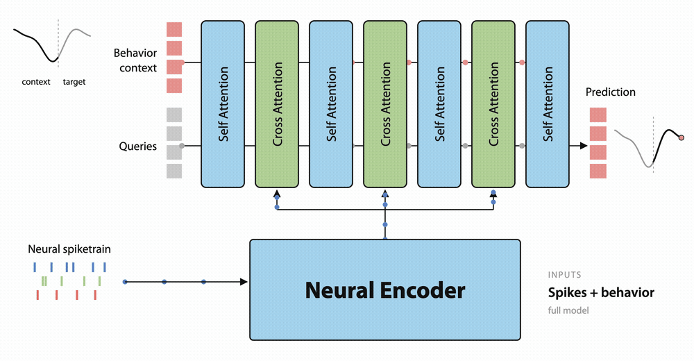

# BEEMO

Official codebase for BEEMO, as presented in "Scaling Neural Motor Decoding via Decoupled Behavioral Pretraining"

BEEMO learns a behavior prior across many sessions and reuses it when decoding behavior from spikes on a new recording. The prior can be learned together with the neural data, or decoupled from it and learned on behavior alone, with a neural encoder attached afterwards.

This repository supports two neural encoders: POYO, a latent-bottleneck transformer with spike tokenization, and NDT, which uses binned tokenization.



## Usage

This project has been developed on Python3.11, with environment management using [`uv`](https://docs.astral.sh/uv/getting-started/installation/). To setup the environment, run:

```bash
source utils/venv_setup.sh
```

This also installs `xformers`, which needs a CUDA GPU. Runs use `precision=bf16` or `fp16`; fp32 is not supported by the attention kernels.

Follow the steps below to pretrain and finetune your own BEEMO model.

### 1. Preprocessing Data

To preprocess datasets, run `brainsets prepare` on each pipeline in `preprocess/`:

```bash
brainsets prepare preprocess/perich_miller_population_2018  --local --raw-dir ../data/raw --processed-dir ../data/processed --cores 8
brainsets prepare preprocess/gallego_carracedo_lfp_2022     --local --raw-dir ../data/raw --processed-dir ../data/processed --cores 8
brainsets prepare preprocess/ma_miller_adversarial_bci_2023 --local --raw-dir ../data/raw --processed-dir ../data/processed --cores 8
brainsets prepare preprocess/churchland_shenoy_neural_2012  --local --raw-dir ../data/raw --processed-dir ../data/processed --cores 8
```

- Pretraining uses the first three. Churchland is only needed for the Jenkins finetuning recordings.
- Gallego and Ma-Miller are downloaded from Dryad, which needs API credentials. Create them at [datadryad.org](https://datadryad.org) (My account → API) and set `DRYAD_APP_ID` and `DRYAD_APP_SECRET` before running.

### 2. Pretraining

Training is configured with [Hydra](https://hydra.cc/). The base command is:

```bash
python train.py --config-name <config> ckpt.enable=true
```

Pick a `<config>` to choose the pretraining mode:

| Mode | `--config-name` | Description |
| --- | --- | --- |
| **Joint** | `beemo_pretrain` (default) | Behavior prior learned together with neural data |
| **Behavior-only** | `beemo_behavior_only_pretrain` | Behavior prior alone, the first stage of the decoupled route |
| **Neural-only** | `base_pretrain` | No behavioral pretraining (ablation) |

Any config value can be overridden on the command line, e.g. `model=beemo_ndt` (options in `configs/model/`). Defaults:

- Data is read from `../data/processed`.
- Checkpoints are written to `../ckpt`.
- See `configs/base.yaml` for the remaining options.

### 3. Finetuning

Each pretraining run prints a `run_id`. Finetune its checkpoint on every held-out recording with the script matching your pretraining mode:

| Pretraining mode | Command |
| --- | --- |
| **Joint** | `python utils/run_finetune.py --ckpt ../ckpt/<run_id>/epoch_99.pt` |
| **Behavior-only** | `python utils/run_neural_finetune.py --ckpt ../ckpt/<run_id>/epoch_99.pt --encoder poyo` |

For behavior-only checkpoints, a fresh neural encoder (`poyo` or `ndt`) is attached. The behavior weights start frozen and are unfrozen at `--unfreeze-at-epoch`.

Both scripts loop over all 27 recordings and share these flags:

- `--recordings`: run a subset
- `--dry-run`: print the commands without running them
- `--unfreeze-at-epoch`: epoch for gradual unfreezing (`-1` unfreezes everything immediately in `run_finetune.py`)
- `--few-shot` (`run_finetune.py` only): use the few-shot split

To finetune on a single recording:

```bash
python train.py --config-name finetune \
    ckpt.load_from=../ckpt/<run_id>/epoch_99.pt \
    data=perich_miller_ft data.args.recording_ids="['t_20130820_random_target_reaching']" \
    finetuning.enable=true finetuning.unfreeze_at_epoch=-1
```

### 4. Single-session Baselines

Train a model from scratch on one recording with the `single_session` config:

```bash
python train.py --config-name single_session data.args.recording_ids="['t_20130819_center_out_reaching']"
```

To sweep hyperparameters per recording with Optuna, pick a `--model` from `poyo`, `ndt`, `linear`, `mlp` or `gru`:

```bash
python utils/run_sweep.py --model poyo
```

- `--gpu-req` and `--cpu-req` set the per-trial resource share, and `--num-samples` the number of trials per recording.
- Each model defines its search space in `create_search_space` and `process_tunable_params`.

### 5. Using Your Own Neural Encoder

To pretrain BEEMO with your own neural encoder, replace the POYO or NDT encoder in `src/model/beemo_poyo.py` or `src/model/beemo_ndt.py` with your custom encoder.

## Citation

If you find this repository useful in your research, please consider giving a star ⭐ and a citation

```bib
TODO
```

## Acknowledgments

> [!NOTE]
> This project utilizes code from and was influenced by [nuclr](https://github.com/nerdslab/nuclr) by [Vinam Arora](https://github.com/vinamarora8). The baselines code was adapted from [ibl-bwb](https://github.com/brainbench-org/ibl-bwb) by [Alexandre Andre](https://github.com/AlexandreAndr) and [Shivashriganesh Mahato](https://github.com/ShivashriganeshMahato).
